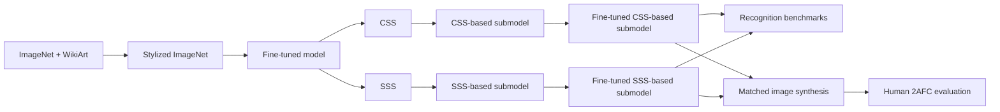

# Content Style Stability

This repository implements the experimental pipeline described in *Subspace Image Synthesis for Style-Invariant Object Recognition*. It uses controlled image sets to compute channel-wise Content and Style Stability Scores, constructs and fine-tunes pruned CNN submodels, and evaluates them through object recognition, image synthesis, and human judgments.

## Pipeline



| Score | Held constant | Varied | Target representation |
| --- | --- | --- | --- |
| CSS | Object content | Visual style | Content stable across styles |
| SSS | Visual style | Object content | Style stable across contents |

## Requirements

- Python 3.11 or later
- [uv](https://docs.astral.sh/uv/) for dependency and virtual-environment management

Install the locked dependencies:

```bash
uv sync
```

## 1. Prepare datasets

Download [ImageNet](https://www.image-net.org/), [Painter by Numbers](https://www.kaggle.com/competitions/painter-by-numbers), and the model-vs-human data. Arrange the external inputs as follows:

- ImageNet: `train/`, `val/`, and `devkit/`
- WikiArt: images under `paintings_raw/`
- Model-vs-human: `stimuli/` and `human_responses/`

Copy the environment template and replace its values with absolute paths:

```bash
cp .env.example .env
```

Generate the datasets used by the experiments:

```bash
uv run content-style-stability-setup --strict
```

This command prepares WikiArt, Stylized ImageNet, ContentConstantDataset, and StyleConstantDataset, including the Stylized ImageNet train/validation split. Completed stages are reused automatically.

## 2. Train, score, prune, and evaluate models

### Fine-tune the base models

Fine-tune the ImageNet-pretrained models on Stylized ImageNet for 50 epochs:

```bash
uv run content-style-stability-train \
  --model vgg19 alexnet resnet50 \
  --dataset imagenet_stylized \
  --epochs 50 \
  --evaluate-each-epoch
```

Each epoch is evaluated on ImageNet validation, Stylized ImageNet (`train_split/val`), and Stylized ImageNet (`val_sorted`). Model checkpoints, including `best.pt`, are saved under `models/train/<run-id>/`; run metadata and `epoch_metrics.csv` remain under `results/runs/train/<run-id>/`. Override the checkpoint root with `--model-output-root` or `CSS_MODELS_ROOT`.

### Calculate scores and prune

Calculate CSS and SSS from each selected base model. The five aggregation rules (average, median, max, min, and entropy) are enabled by default:

```bash
base_checkpoint="REPLACE_WITH_BEST_CHECKPOINT_PATH_FROM_RESULTS_CSV"

uv run content-style-stability-calc-score \
  --model "$base_checkpoint" \
  --dataset both
```

Scores are saved under `scores/<model-key>/content_constant/` for CSS and `scores/<model-key>/style_constant/` for SSS, including pilot calculations. Override this root with `--output-root` or `CSS_SCORES_ROOT`. Set the model directory reported in the calculation run's results.csv, then create the 110 pruned models:

```bash
score_root="scores/REPLACE_WITH_MODEL_KEY"
criteria=(
  "$score_root"/{content_constant,style_constant}/cosine_similarity_{average,median,max,min,entropy}.pkl
)

uv run content-style-stability-prune \
  --model "$base_checkpoint" \
  --pruning-rates 0 0.1 0.2 0.3 0.4 0.5 0.6 0.7 0.8 0.9 1.0 \
  --criteria "${criteria[@]}" \
  --rate-schedule skip_first
```

This creates 11 pruning rates for each of the five CSS and five SSS aggregation rules: 10 score/aggregation combinations × 11 rates = 110 checkpoints. Pruned checkpoints are saved under `models/prune/<run-id>/`; run metadata remains under `results/runs/prune/<run-id>/`.

### Fine-tune and evaluate the submodels

Repeat the following commands for every checkpoint listed in the pruning run's
`results.csv`:

```bash
pruned_checkpoint="REPLACE_WITH_PRUNED_CHECKPOINT_PATH"

uv run content-style-stability-train \
  --model "$pruned_checkpoint" \
  --dataset imagenet \
  --epochs 1

submodel_checkpoint="REPLACE_WITH_FINE_TUNED_CHECKPOINT_PATH"

for dataset in imagenet imagenet_stylized model_vs_human; do
  uv run content-style-stability-evaluate \
    --model "$submodel_checkpoint" \
    --dataset "$dataset"
done
```

Pruning masks remain active during fine-tuning. Repeat this procedure for all 110 checkpoints produced from each base model.

## 3. Synthesize images from CSS and SSS submodels

Use the fine-tuned VGG19 checkpoints from CSS-average and SSS-minimum at 30% pruning. Generate both conditions from five ImageNet content images and 500 WikiArt styles:

```bash
css_checkpoint="REPLACE_WITH_FINE_TUNED_VGG19_CSS_AVERAGE_30_CHECKPOINT"
sss_checkpoint="REPLACE_WITH_FINE_TUNED_VGG19_SSS_MINIMUM_30_CHECKPOINT"
mass_run_dir="results/runs/mass_generation/vgg19_css_sss"

uv run content-style-stability-mass-generation \
  --css-checkpoint "$css_checkpoint" \
  --sss-checkpoint "$sss_checkpoint" \
  --output-root "$mass_run_dir"
```

The command generates CSS and SSS images from the same content-style pairs and validates the synthesis masks automatically. Mass generation can take long time; add `--resume` to the same command after an interruption.

Create the screening manifest, then select five styles for each condition using LPIPS:

```bash
uv run content-style-stability-screening manifest \
  --run-dir "$mass_run_dir"

uv run content-style-stability-screening lpips \
  --run-dir "$mass_run_dir" \
  --styles-per-condition 5
```

The manifest records content-correlation and high-frequency artifact metrics for audit but does not apply automatic QC by default. Add `--auto-qc` to enable content-correlation screening, and additionally pass `--screen-high-frequency-artifacts` to enable the RGB-neighbor, high-frequency-residual, and neighbor-correlation warnings.

LPIPS-Alex selects five CSS styles and five SSS styles (10 in total), with no style shared between the two conditions. The selected images and the behavioral-experiment input `behavior_trials.csv` are written below `$mass_run_dir/screening/lpips/`.

## 4. Run the behavioral experiment

Run the four-image style-reflection 2AFC experiment using the trial CSV created in step 3:

```bash
trials_csv="$mass_run_dir/screening/lpips/behavior_trials.csv"

uv run python -m experiment.run_style_reflection_experiment \
  --mode gui \
  --trials-csv "$trials_csv" \
  --participant-id "<participant-id>" \
  --session-id "<session-id>"
```

The default configuration reproduces the `proj_metamer_cornet` protocol: it uses the calibrated display-gamma profile, a 5 cm stimulus frame, a 1000 ms stimulus duration, a 500 ms response-to-next-trial ITI, and the legacy seeded trial/side randomization. Use `--no-display-gamma` only when the experimental monitor has not been calibrated with that profile. The experiment presents 500 trials and saves responses below `experiment/results/runs/behavior_experiment/`.

## 5. Analysis

### Behavioral responses and figures

Fit the paper's behavioral GLMM and statistical tests, then generate Figures 7, 17, and 18 from the resulting CSV files:

```bash
analysis_run="$(uv run content-style-stability-analyze-behavior)"

uv run content-style-stability-figure-behavior \
  --analysis-run "$analysis_run"
```

Analysis outputs are saved below `experiment/results/runs/behavior_analysis/`; PDF figures are saved below `experiment/results/runs/behavior_figures/`. Add `--png` and/or `--svg` to create those formats as well.

### Model evaluations and figures

Analyze the sample-level prediction tables produced in step 2, then create the pruning-curve and normalized-AUC figures:

```bash
evaluation_root="results/runs/evaluate"

model_analysis_run="$(uv run content-style-stability-analyze-model-evaluation \
  --evaluation-root "$evaluation_root")"

uv run content-style-stability-figure-model-evaluation \
  --analysis-run "$model_analysis_run"
```

The analysis uses 1,000 shared bootstrap resamples by default. PDF figures are written below `results/runs/model_evaluation_figures/`; add `--png` and/or `--svg` for additional formats. When both pre- and post-fine-tuning evaluation grids are available, the figure run also writes the architecture-specific 6-by-4 pruning-curve grids used for Appendix Figures 9--12 (AlexNet, VGG-19, ResNet-50, and CORnet-S).

For prediction tables created by the previous project, first create a canonical copy and pass the printed run directory to the analysis command:

```bash
evaluation_root="$(uv run content-style-stability-convert-model-evaluation \
  --input-run <legacy-evaluation-run>)"
```

### Exclusive-channel stability distributions

For the VGG-19 submodels used in synthesis, compare the CSS and SSS distributions of channels retained exclusively by the 30% CSS-average and SSS-minimum checkpoints:

```bash
exclusive_analysis_run="$(uv run content-style-stability-analyze-exclusive-channels \
  --css-checkpoint <css-average-pr030-checkpoint> \
  --sss-checkpoint <sss-minimum-pr030-checkpoint> \
  --css-raw-score scores/<model-key>/content_constant/cosine_similarity.pkl \
  --sss-raw-score scores/<model-key>/style_constant/cosine_similarity.pkl)"

uv run content-style-stability-figure-exclusive-channels \
  --analysis-run "$exclusive_analysis_run"
```

The analysis aggregates CSS with the mean and SSS with the minimum, matching the selected submodels. It uses 200 stimulus-group bootstrap replicates by default. Within each score type, every replicate shares the same resampled groups across the CSS-exclusive and SSS-exclusive channel sets. CSV artifacts are written below `results/runs/exclusive_channel_analysis/`, and the ECDF PDF is written below `results/runs/exclusive_channel_figures/`.

## 6. Behavioral-response data

The de-identified main-study responses are available in [`experiment/data/responses.csv`](experiment/data/responses.csv). The table contains 5,000 trials from 10 participants (500 trials per participant). Participant, content, style, and condition identifiers were replaced with release-specific identifiers.

## References

- [pytorch-AdaIN](https://github.com/naoto0804/pytorch-AdaIN)
- [ImageNet](https://www.image-net.org/)
- [Painter by Numbers](https://www.kaggle.com/competitions/painter-by-numbers)
